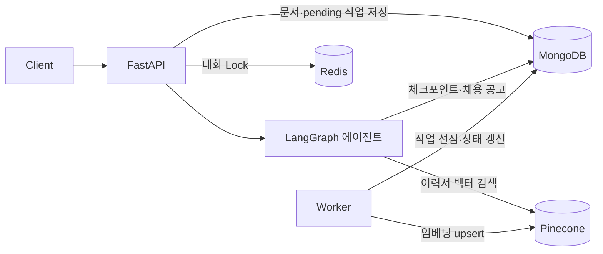
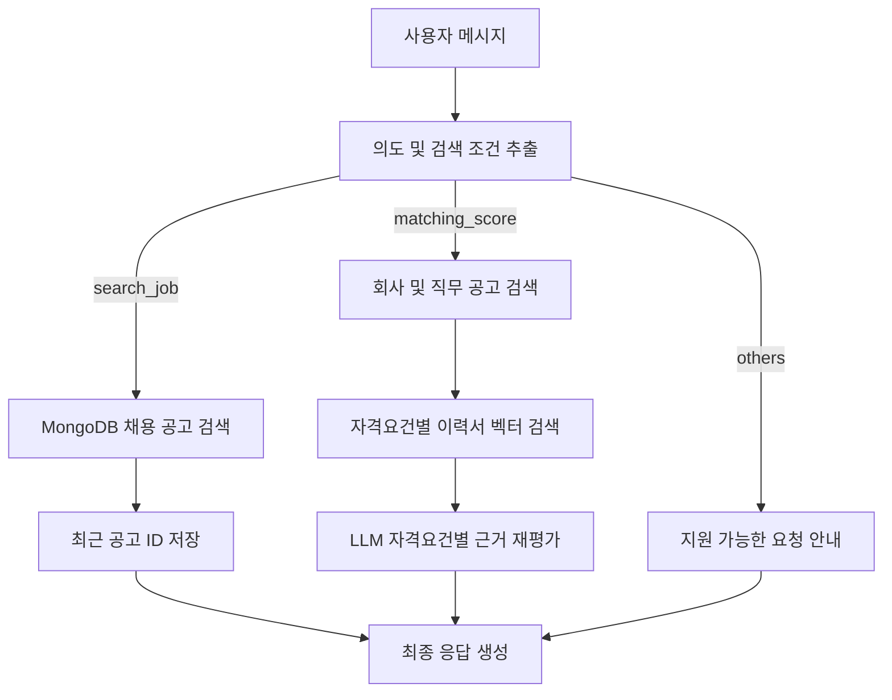
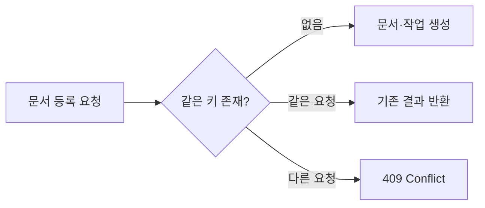
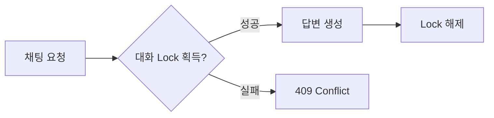
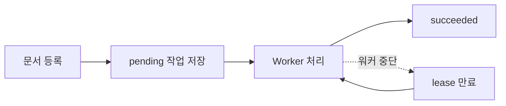

# Job Fit Agent

자연어로 채용 공고를 검색하고, 등록한 이력서를 근거로 공고별 지원 적합도를 평가하는 **LangGraph 기반 AI 채용 에이전트**입니다.

기능 구현 이후 **재시도, 동시 요청, 워커 장애** 상황에서도 데이터가 중복되거나 유실되지 않도록 백엔드 안정성을 개선했습니다.

| 개선 항목 | 해결한 문제 | 핵심 기술 | 검증 결과 (k6) |
| --- | --- | --- | --- |
| [문서 등록 멱등성](#1-문서-등록-멱등성) | 재시도·동시 요청 시 문서·작업 중복 생성 | Idempotency-Key, 요청 해시, MongoDB 유니크 복합 인덱스 | 중복률 **95% → 0%** |
| [대화별 동시성 제어](#2-대화별-동시성-제어) | 같은 대화의 동시 요청으로 상태 충돌·LLM 중복 호출 | Redis 분산 락 (`SET NX EX`, Lua 해제) | 중복 실행 **4회 → 0회** |
| [비동기 인덱싱·장애 복구](#3-비동기-문서-인덱싱과-장애-복구) | 임베딩 대기로 응답 지연, 워커 중단 시 작업 방치 | 작업 큐 컬렉션, 원자적 선점, lease 만료 재처리 | 복구율 **0% → 100%** |

## 목차

- [주요 기능](#주요-기능)
- [아키텍처](#아키텍처)
- [안정성 개선](#안정성-개선)
- [기술 스택](#기술-스택)
- [프로젝트 구조](#프로젝트-구조)
- [실행 방법](#실행-방법)
- [API](#api)
- [테스트](#테스트)
- [한계와 다음 단계](#한계와-다음-단계)
- [상세 문서](#상세-문서)

## 주요 기능

### 자연어 기반 채용 공고 검색

사용자 문장에서 의도와 검색 조건(직무, 기술 키워드, 지역, 고용 형태)을 한 번의 LLM 호출로 추출한 뒤 MongoDB의 채용 공고를 검색합니다.

```text
사용자: 서울 Python 백엔드 공고 찾아줘
→ intent: search_job, keyword: Python 백엔드, job_title: 백엔드 개발자, location: 서울
```

검색 결과의 공고 ID 순서를 대화 상태에 저장하므로, 이어서 "2번 공고 분석해줘"처럼 질문하면 해당 공고로 적합도 분석을 실행합니다.

### 이력서 등록과 벡터 검색

이력서 원문과 버전은 MongoDB에, 청크 임베딩은 Pinecone에 저장합니다.

- Namespace: `user-{user_uuid}` (사용자별 데이터 분리)
- Vector ID: `{document_id}:v{version}:chunk:{chunk_index}` (결정적 ID로 재처리 시 중복 방지)
- 등록·수정·삭제는 비동기 작업으로 처리되며, 인덱싱에 성공한 버전만 검색에 노출됩니다.

### 공고 지원 적합도 분석

1. 회사명과 직무명으로 채용 공고 검색
2. 공고의 자격요건(`qualifications`)을 각각 검색 쿼리로 사용해 이력서 근거 검색
3. 검색된 이력서 원문을 LLM이 다시 검토해 자격요건별로 판정
4. 강점, 보완점, 종합 점수 생성

판정은 `satisfied`, `partially_satisfied`, `insufficient_evidence` 세 가지입니다. 벡터 유사도는 근거 후보를 찾는 데만 쓰고, 최종 판단은 LLM이 원문을 보고 내립니다.

## 아키텍처



| 구성 요소 | 역할 |
| --- | --- |
| FastAPI | JWT 인증, 대화·채팅, 문서 등록 API. 문서 등록은 작업만 저장하고 `202 Accepted`로 즉시 응답 |
| LangGraph | 의도 추출 → 공고 검색 또는 자격요건별 근거 검색 → 적합도 평가 → 응답 생성 |
| MongoDB | 채용 공고, 이력서·버전, 작업 큐(`document_jobs`), 대화별 LangGraph 체크포인트 |
| Redis | 대화별 분산 락, Refresh Token 회전 |
| Worker | 작업을 원자적으로 선점해 청크 분할, 임베딩, Pinecone 저장 수행 |
| Pinecone | 사용자별 namespace로 분리된 이력서 청크 벡터 |

### 에이전트 워크플로



각 채팅은 `conversation_id`를 LangGraph `thread_id`로 사용해 MongoDB 체크포인트에 대화별 상태를 저장합니다.

## 안정성 개선

### 1. 문서 등록 멱등성

**문제.** 등록 응답이 유실되면 클라이언트는 같은 요청을 다시 보냅니다. 요청마다 문서와 작업을 새로 만들면 이력서, 임베딩 비용, Pinecone 벡터가 모두 중복됩니다. "조회 후 없으면 생성" 방식은 동시 요청 사이의 경쟁 조건 때문에 중복을 막지 못합니다.



**설계와 구현.**

- 요청 식별 범위는 `owner_user_uuid + job_type + idempotency_key`입니다. 다른 사용자가 같은 키를 써도 충돌하지 않습니다.
- `title`, `content`를 정규화한 SHA-256 해시로 같은 요청인지 판별합니다. 원문 대신 해시만 작업 기록에 저장합니다.
- 선조회는 빠른 경로로만 쓰고, 동시성 보장은 MongoDB 유니크 복합 인덱스에 맡겼습니다.
- 동시 요청이 먼저 작업을 만들어 `DuplicateKeyError`가 나면, 방금 만든 문서를 삭제(보상 처리)하고 먼저 생성된 결과를 반환합니다.

```javascript
db.document_jobs.createIndex(
  { job_type: 1, idempotency_key: 1, owner_user_uuid: 1 },
  { unique: true, name: "uniq_document_job_idempotency" }
)
```

**검증.** 같은 사용자, 같은 키, 같은 내용의 요청 20건을 동시에 전송했습니다.

| 지표 | 개선 전 | 개선 후 |
| --- | --- | --- |
| 생성된 문서 수 | 20개 | **1개** |
| 중복 생성 | 19건 | **0건** |
| 중복률 | 95% | **0%** |
| 같은 키·다른 내용 재요청 | 새 문서 생성 | `409 Conflict` |

중복률 = (생성 문서 수 − 1) / 요청 수

### 2. 대화별 동시성 제어

**문제.** 버튼 연타나 여러 탭에서 같은 대화에 동시에 요청하면, 두 그래프 실행이 같은 체크포인트를 읽고 덮어써 상태가 꼬이고 LLM 호출도 중복됩니다. 반대로 모든 요청을 직렬화하면 관계없는 대화까지 기다리게 됩니다.



**설계와 구현.**

- 락 키를 `lock:conversation:{conversation_id}`로 두어 같은 대화만 상호 배제하고, 다른 대화는 병렬로 처리합니다.
- API 서버를 여러 인스턴스로 늘려도 동작하도록 프로세스 내 락 대신 Redis를 사용합니다.
- `SET key token NX EX 120`으로 원자적으로 획득합니다. 서버가 죽어도 TTL이 지나면 락이 자동 해제됩니다.
- 해제는 Lua 스크립트로 "내 토큰일 때만 삭제"합니다. TTL 만료 후 다른 요청이 잡은 락을 지우는 문제를 막습니다.
- LLM 응답은 오래 걸릴 수 있어, 대기열에 쌓지 않고 `409 Conflict`로 즉시 거절합니다.

```lua
if redis.call("get", KEYS[1]) == ARGV[1] then
    return redis.call("del", KEYS[1])
else
    return 0
end
```

**검증.** 같은 대화에 메시지 5건을 동시에 전송했습니다.

| 지표 | 개선 전 | 개선 후 |
| --- | --- | --- |
| 그래프 실행 횟수 | 5회 | **1회** |
| 중복 실행 | 4회 | **0회** (4건 `409`) |
| 서로 다른 대화 동시 요청 | 모두 처리 | **모두 `200`, 병렬 처리** |

### 3. 비동기 문서 인덱싱과 장애 복구

**문제.** 청크 분할, 임베딩 API, Pinecone 저장을 동기로 처리하면 응답 속도가 외부 API에 묶입니다. 처리 중 프로세스가 죽으면 작업이 "진행 중" 상태로 남아 끝나지 않고, 워커가 여러 개면 같은 작업을 동시에 처리할 수 있습니다.



**설계와 구현.**

- API는 문서와 `pending` 작업만 저장하고 `202 Accepted`와 `job_id`를 반환합니다. 진행 상황은 `GET /jobs/{job_id}`로 확인합니다.
- 별도 메시지 큐 대신 MongoDB `document_jobs` 컬렉션을 작업 큐로 사용합니다. 상태, 시도 횟수, 오류를 한곳에서 조회할 수 있습니다.
- `find_one_and_update`로 상태 전이를 원자적으로 수행해, 여러 워커 중 하나만 작업을 가져갑니다.
- 선점한 워커는 `lease_until`(기본 60초)까지만 소유권을 가집니다. lease가 지나면 다른 워커가 작업을 다시 선점합니다.
- 선점할 때마다 `attempts`를 증가시키고 최대 3회까지만 재시도합니다.
- 결정적 벡터 ID로 upsert하므로 재처리되어도 벡터가 중복되지 않습니다.

```python
job = await db.document_jobs.find_one_and_update(
    {
        "_id": job_id,
        "$or": [
            {"status": "pending"},
            {"status": "running", "lease_until": {"$lte": now}},
        ],
        "$expr": {"$lt": ["$attempts", "$max_attempts"]},
    },
    {
        "$set": {"status": "running", "lease_until": lease_until},
        "$inc": {"attempts": 1},
    },
    return_document=ReturnDocument.AFTER,
)
```

**검증.** 워커를 멈춘 상태에서 작업 100건을 만들고, lease가 만료된 `running` 상태로 바꿔 크래시를 재현한 뒤 워커를 재시작했습니다.

| 지표 | 개선 전 | 개선 후 |
| --- | --- | --- |
| 주입한 만료 작업 | 100건 | 100건 |
| 자동 복구 | 0건 (복구 기능 없음) | **100건** |
| 복구율 | 0% | **100%** |
| 최종 실패 | — | **0건** |
| 중복 문서·벡터 | — | **0건** |

### 문서 버전 관리

이력서를 수정하면 `current_version`을 원자적으로 증가시키고, 해당 버전의 원문 스냅샷과 인덱싱 작업을 함께 만듭니다. 인덱싱에 성공한 버전만 `active_version`으로 전환하므로, 새 버전 인덱싱이 실패해도 검색에는 직전 정상 버전이 계속 노출됩니다. 자세한 내용은 [문서 버전 관리](docs/document-versioning.md)를 참고하세요.

## 기술 스택

| 구분 | 기술 |
| --- | --- |
| Backend | Python 3.12, FastAPI, Uvicorn, Pydantic |
| AI Workflow | LangGraph, LangChain, Langfuse (추적) |
| LLM / Embedding | OpenAI-compatible Chat API, Embedding API |
| Database | MongoDB, Redis |
| Vector Database | Pinecone |
| Auth | Argon2id, JWT Access Token, Redis Refresh Token 회전 |
| Infra | Docker, Docker Compose, GitHub Actions, Raspberry Pi (ARM64) |
| Test | k6 |

## 프로젝트 구조

```text
.
├── app.py                        # FastAPI 앱, lifespan, 라우터 등록
├── worker.py                     # 문서 인덱싱·정리 작업 Worker
├── graph.py                      # LangGraph 노드 및 조건부 엣지
├── nodes.py                      # 의도 분류, 공고 검색, 적합도 분석 노드
├── state.py                      # 그래프 상태와 LLM 구조화 출력 모델
├── schema.py                     # API 요청/응답 모델
├── database.py                   # MongoDB·Redis 연결 관리
├── config.py                     # 환경변수
├── llm.py                        # Chat LLM 생성
├── observability.py              # Langfuse 연동
├── api/
│   ├── auth.py                   # 회원가입, 로그인, 토큰 갱신, 로그아웃
│   ├── conversations.py          # 대화 생성·조회, 채팅
│   ├── profile.py                # 프로필, 이력서 등록·수정·삭제·검색
│   ├── jobs.py                   # 문서 작업 상태 조회
│   ├── postings.py               # 추천 공고 조회
│   └── health.py
├── service/
│   ├── idempotency.py            # Idempotency-Key 정규화, 요청 해시
│   ├── conversation_lock.py      # Redis 대화 락
│   ├── document_job_service.py   # 작업 생성·선점·처리, 문서 버전
│   ├── embedding_service.py      # 청킹, 임베딩
│   ├── vector_store.py           # Pinecone 저장·검색·삭제
│   ├── refresh_token.py          # Refresh Token 회전
│   └── ...
├── tests/load/                   # k6 부하·동시성·복구 테스트
├── reports/                      # k6 HTML 리포트
├── docs/                         # 기능별 상세 문서
├── Dockerfile
└── compose.yaml
```

## 실행 방법

### 1. 패키지 설치

```bash
git clone https://github.com/qwerty0911/job-fit-agent.git
cd job-fit-agent

uv venv --python 3.12
source .venv/bin/activate
uv pip install -r requirements.lock
```

### 2. 환경변수 설정

```bash
cp .env.example .env
```

주요 항목은 다음과 같습니다. 전체 목록은 [.env.example](.env.example)을 참고하세요.

| 변수 | 설명 |
| --- | --- |
| `OPENAI_API_KEY`, `OPENAI_MODEL`, `OPENAI_BASE_URL` | 채팅 LLM |
| `EMBEDDING_API_KEY`, `EMBEDDING_BASE_URL`, `EMBEDDING_MODEL` | 임베딩 모델 |
| `MONGODB_URI`, `MONGODB_DB_NAME` | MongoDB |
| `REDIS_URL` | Redis (대화 락, Refresh Token) |
| `PINECONE_API_KEY`, `PINECONE_INDEX_NAME`, `PINECONE_INDEX_HOST` | Pinecone. 인덱스 dimension은 임베딩 모델 출력 차원과 같아야 합니다. |
| `JWT_SECRET_KEY` | Access Token 서명 키 |
| `DOCUMENT_JOB_LEASE_SECONDS` | 작업 lease 시간 (기본 60초) |
| `LANGFUSE_*` | 선택. LLM 호출 추적 |

### 3. 서버와 Worker 실행

```bash
# Redis (로컬에 없을 때)
docker compose up -d redis

# API 서버
uvicorn app:app --reload

# Worker (별도 터미널)
python worker.py
```

- API 문서: `http://127.0.0.1:8000/docs`
- 상태 확인: `http://127.0.0.1:8000/health`

Worker가 실행 중이어야 이력서 등록·수정·삭제 작업이 처리됩니다.

### 4. 채용 공고 데이터

채용 공고는 MongoDB `job_postings` 컬렉션에 저장합니다.

```json
{
  "company_name": "테크웨이브",
  "job_title": "백엔드 개발자",
  "tech_stack": ["Python", "FastAPI", "MongoDB"],
  "qualifications": ["Python 기반 애플리케이션 개발 경험", "비동기 처리에 대한 이해"],
  "preferred_qualifications": ["LangGraph 사용 경험"],
  "location": "서울",
  "job_type": "정규직"
}
```

### Docker 배포

Docker 이미지 빌드, ARM64 빌드, 라즈베리 파이 배포는 [배포 안내](docs/deployment.md)를 참고하세요.

## API

`/signup`, `/login`, `/health`를 제외한 모든 API는 `Authorization: Bearer <access_token>` 헤더가 필요합니다.

| Method | Path | 설명 |
| --- | --- | --- |
| POST | `/signup` | 회원가입 |
| POST | `/login` | 로그인 (Access Token 발급, Refresh Token 쿠키) |
| POST | `/auth/refresh` | Refresh Token 회전 |
| POST | `/auth/logout` | 로그아웃 |
| GET | `/auth/me` | 현재 사용자 |
| GET | `/profile/me` | 프로필 조회 |
| POST | `/profile/add_skills` | 기술 스택 추가 |
| POST | `/profile/documents` | 이력서 등록 (`Idempotency-Key` 필수, `202`) |
| PUT | `/profile/documents/{document_id}` | 이력서 수정, 새 버전 인덱싱 (`202`) |
| DELETE | `/profile/documents/{document_id}` | 이력서 삭제, 벡터 정리 (`202`) |
| POST | `/profile/documents/search` | 여러 쿼리로 이력서 검색 |
| GET | `/jobs/{job_id}` | 문서 작업 상태 조회 |
| POST | `/conversations` | 대화 생성 |
| GET | `/conversations` | 대화 목록 |
| GET | `/conversations/{conversation_id}` | 대화 조회 |
| POST | `/conversations/{conversation_id}/chat` | 채팅 (처리 중이면 `409`) |
| GET | `/postings/me` | 추천 공고 조회 |

### 예시: 이력서 등록

```http
POST /profile/documents
Authorization: Bearer <access_token>
Idempotency-Key: resume-request-001
Content-Type: application/json

{
  "title": "백엔드 개발자 이력서",
  "content": "Python과 FastAPI를 사용해 비동기 API 서버를 개발했습니다."
}
```

```json
{ "document_id": "...", "job_id": "...", "status": "pending" }
```

같은 키와 같은 내용으로 다시 요청하면 같은 `document_id`, `job_id`가 반환되고, 같은 키에 다른 내용을 보내면 `409 Conflict`가 반환됩니다.

### 예시: 채팅

```http
POST /conversations/{conversation_id}/chat
Authorization: Bearer <access_token>
Content-Type: application/json

{ "message": "테크웨이브 백엔드 개발자 공고에 지원할 만할까?" }
```

## 테스트

k6로 멱등성, 대화 동시성, 병렬 처리, 워커 복구를 검증합니다. 실행 방법과 MongoDB 확인 쿼리는 [tests/load/README.md](tests/load/README.md)에 있습니다.

| 스크립트 | 검증 내용 |
| --- | --- |
| `document_idempotency.js` | 같은 키 동시 등록, 워커 복구용 작업 생성 |
| `conversation-concurrency.js` | 같은 대화 동시 요청 시 1건만 처리 |
| `conversation-parallel.js` | 서로 다른 대화의 병렬 처리 |
| `health.js` | 기본 부하 |

`409`가 의도한 결과인 테스트는 k6 기본 실패율 대신 `200`/`409` 커스텀 카운터와 MongoDB 결과로 판정합니다.

## 한계와 다음 단계

| 한계 | 개선 방향 |
| --- | --- |
| 문서 저장과 작업 생성 사이에 프로세스가 죽으면 작업 없는 문서가 남을 수 있음 | MongoDB 트랜잭션 또는 Outbox 패턴 |
| 대화 락 TTL이 120초로 고정되어, 실행이 더 길어지면 중복 실행 가능 | 실행 중 TTL 연장(watchdog), fencing token |
| lease 60초를 넘는 정상 작업도 다른 워커가 재선점할 수 있음 | 처리 중 lease 갱신(heartbeat) |
| 임베딩 호출 직후 장애 시 외부 API 호출이 중복될 수 있음 | exactly-once는 불가하다는 전제로 결과 저장 멱등성 유지 |
| Worker가 2초 주기로 폴링 | MongoDB Change Streams 또는 Redis 큐 기반 알림 |
| 공고 검색이 직무 키워드 중심이라 동의어·복합 조건 처리가 제한적 | 검색 조건과 동의어 처리 개선 |
| 그래프 진행 상태를 실시간으로 전달하지 않음 | SSE 스트리밍 |

## 상세 문서

- [인증](docs/authentication.md)
- [대화와 동시성 제어](docs/conversations.md)
- [문서 등록 멱등성](docs/idempotency.md)
- [비동기 문서 처리](docs/document-processing.md)
- [문서 버전 관리와 인덱스 정합성](docs/document-versioning.md)
- [배포](docs/deployment.md)
